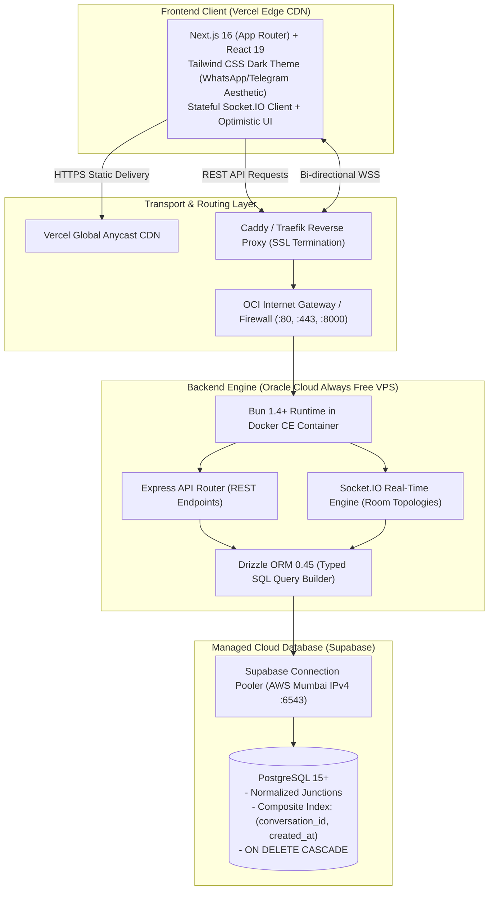
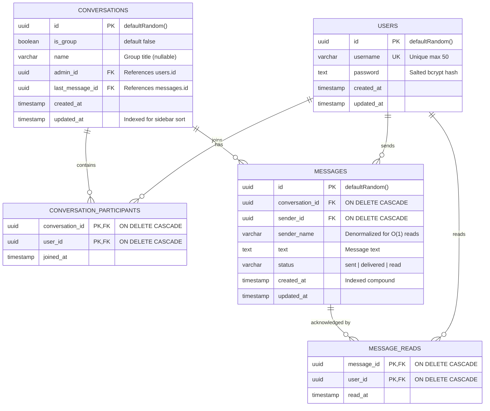

<div align="center">

# 💬 Enterprise Real-Time Chat Platform
### High-Performance Full-Stack Messaging Platform with Zero-Sleep Cloud Architecture

[](https://nextjs.org/)
[](https://react.dev/)
[](https://bun.sh/)
[](https://www.postgresql.org/)
[](https://orm.drizzle.team/)
[](https://socket.io/)
[](https://tailwindcss.com/)
[](https://www.oracle.com/cloud/free/)
[](https://vercel.com/)
[](LICENSE)

<br/>

**[🌐 Live Production Website](https://chat-application-mocha-xi.vercel.app)** • **[⚡ Backend API Health](http://xvg69sogcx42p7o5ewsxh84m.144.24.112.62.sslip.io/health)**

</div>

---

## 🌟 Key Features

* 🚀 **Sub-200ms Real-Time Messaging**: Built on persistent bi-directional WebSockets with room-scoped message broadcasting.
* 💬 **1-on-1 Direct & Multi-User Group Channels**: Create instant private chats or multi-member group channels with admin roles and dynamic membership.
* 🟢 **Live Presence Engine**: Real-time online/offline indicators across multi-device/multi-tab user sessions.
* ✍️ **Ephemeral Typing Indicators**: Debounced and throttled `user_typing` and `user_stop_typing` broadcasts.
* ⏱️ **Zero-Flicker Optimistic UI**: Immediate local message dispatch with temporary UUID reconciliation upon server acknowledgment.
* ✓✓ **WhatsApp-Style Read Receipts**: Real-time message status transitions (`sending` $\to$ `sent` $\to$ `read`).
* 🗑️ **Full Data Lifecycle Control**: "Delete for everyone" message removal, "Clear Chat History", and full conversation removal via PostgreSQL `ON DELETE CASCADE`.
* 🛡️ **Stateless JWT & Bcrypt Authentication**: Salted password hashing and cryptographic socket handshake token verification.
* 📊 **Cursor-Based Pagination**: Millisecond timestamp seeks via compound B-Tree indexing on `(conversation_id, created_at)`.
* 🧹 **Automated Database Storage Retention**: Built-in CLI retention pruner (`bun run cleanup`) and secured admin API endpoint to prevent database bloat.
* 💰 **100% Free Hosting Architecture**: Self-hosted on an **Oracle Cloud Always Free VPS (4 ARM OCPUs, 24 GB RAM)** via Coolify and **Vercel Edge CDN** at $0.00/month cost with zero sleep lag.

---

## 🏗️ System Architecture



---

## 🛠️ Tech Stack

| Layer | Technology | Rationale |
| :--- | :--- | :--- |
| **Frontend Framework** | [Next.js 16 (App Router)](https://nextjs.org/) + [React 19](https://react.dev/) | High-speed Server Components, React 19 actions, Turbopack builds |
| **Styling & UI** | [Tailwind CSS](https://tailwindcss.com/) + [Lucide Icons](https://lucide.dev/) | WhatsApp / Telegram Dark Theme (`#0b141a`, `#00a884`, `#005c4b`) |
| **Backend Runtime** | [Bun 1.4+](https://bun.sh/) | Ultra-fast JavaScript runtime, native TypeScript execution, instant cold starts |
| **API & Realtime** | [Express 5](https://expressjs.com/) + [Socket.IO 4.8](https://socket.io/) | Robust REST routing, room-based WebSocket broadcasting, handshake JWT validation |
| **Database & ORM** | [PostgreSQL 15](https://www.postgresql.org/) + [Drizzle ORM](https://orm.drizzle.team/) | Strict relational integrity, `ON DELETE CASCADE`, composite B-Tree cursor pagination |
| **Managed DB Host** | [Supabase](https://supabase.com/) | Managed PostgreSQL with built-in AWS Mumbai IPv4 Connection Pooler |
| **Backend Hosting** | [Oracle Cloud (OCI)](https://www.oracle.com/cloud/free/) + [Coolify](https://coolify.io/) | 4 ARM OCPUs, 24 GB RAM, 200 GB SSD Always Free VM with self-hosted PaaS |
| **Frontend Hosting** | [Vercel](https://vercel.com/) | Global Anycast Edge CDN delivery |

---

## 🗄️ Database Schema & Relational Design



---

## 🚀 Quick Start (Local Development)

### 1. Prerequisites
* **Bun (v1.4+)**: [Install Bun](https://bun.sh/) (`curl -fsSL https://bun.sh/install | bash`)
* **PostgreSQL Database**: Free cloud database on [Supabase](https://supabase.com) or local PostgreSQL instance.

### 2. Backend Setup
```bash
cd backend

# Install dependencies
bun install

# Configure environment variables (.env)
cp .env.example .env
# Edit .env with your DATABASE_URL, JWT_SECRET, PORT=5000, FRONTEND_URL=http://localhost:3000

# Push database schema to PostgreSQL
bun run db:push

# Start development server
bun run dev
```
* Backend will be running at: `http://localhost:5000`
* Run test suite: `bun test`

### 3. Frontend Setup
```bash
cd ../frontend

# Install dependencies
bun install

# Configure environment variables (.env.local)
echo "NEXT_PUBLIC_BACKEND_URL=http://localhost:5000" > .env.local

# Start Next.js development server
bun run dev
```
* Frontend will be accessible at: `http://localhost:3000`

---

## 🧹 Database Maintenance & Storage Retention

To ensure the database stays lean and under free storage quotas:

```bash
cd backend

# Purge automated test accounts (alpha_*, live_*, test_*) and empty conversations
bun run cleanup

# Enforce a 30-day message retention policy
bun run cleanup:30days

# Full database message reset (development testing)
bun run cleanup:all
```

---

## 🧪 Testing & Verification

The project includes unit, integration, and live end-to-end production test suites:

```bash
cd backend
bun test
```

```text
 26 pass
 0 fail
 70 expect() calls
Ran 26 tests across 6 files. [100% Pass Rate]
```

---

## 📄 License

This project is open-source and available under the [MIT License](LICENSE).
