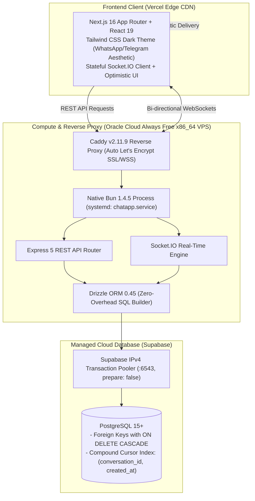
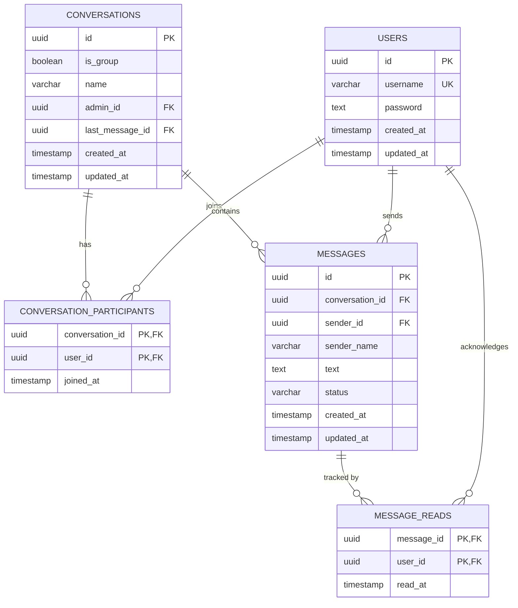
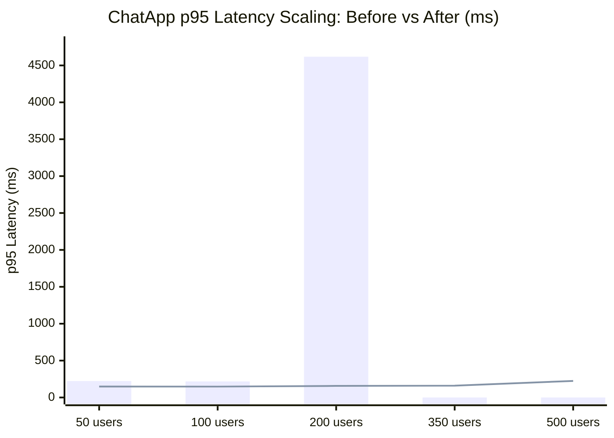

<div align="center">

# ChatApp — Real-Time Messaging Platform

A full-stack, low-latency messaging platform built with Next.js 16, Bun, PostgreSQL (Drizzle ORM), and Socket.IO.  
Hosted 24/7 with zero sleep timers on Oracle Cloud Always Free Infrastructure and Vercel.

<br/>

[](https://nextjs.org/)
[](https://react.dev/)
[](https://bun.sh/)
[](https://www.typescriptlang.org/)
[](https://www.postgresql.org/)
[](https://orm.drizzle.team/)
[](https://socket.io/)
[](https://tailwindcss.com/)

[](https://www.oracle.com/cloud/free/)
[](https://caddyserver.com/)
[](https://supabase.com/)
[](https://vercel.com/)
[](LICENSE)

<br/>
<br/>

**[ 🚀 Live Demo ](https://chat-application-mocha-xi.vercel.app)** &nbsp;•&nbsp; **[ ⚡ API Health Check ](https://130.210.55.231.sslip.io/health)** &nbsp;•&nbsp; **[ 🧪 Run Tests ](#testing)** &nbsp;•&nbsp; **[ 📦 Quickstart ](#getting-started)** &nbsp;•&nbsp; **[ 🏗️ Architecture ](#architecture--engineering-decisions)**

<br/>
<br/>


</div>

---

## Overview

Most real-time chat side-projects either rely on expensive third-party wrappers (Pusher, Firebase) or suffer from free-tier cold-starts (where platforms like Render or Railway sleep after 15 minutes of inactivity, causing 30–50 second lag on waking).

I built **ChatApp** to solve this problem from first principles: a modern, decoupled messaging platform with sub-200ms round-trip latency, full relational data integrity, optimistic UI updates, and automated storage retention—hosted on dedicated Always Free cloud infrastructure without monthly hosting bills or sleep timers.

---

## Key Features

### 1. Real-Time Communication & Messaging
- **1-on-1 Direct & Multi-User Groups**: Start instant direct chats or create named group channels with dynamic participant lists.
- **Room-Scoped Event Broadcasting**: Sockets join isolated conversation rooms (`conv_${conversationId}`) rather than polluting the global namespace.
- **Optimistic UI Dispatch**: Messages render locally with a temporary ID and transition to double checkmarks (`✓✓`) as soon as the server acknowledges the write.
- **Delivery & Read Receipts**: Real-time read synchronization across all participants when a chat is opened.
- **Ephemeral State**: Debounced typing indicators (`user_typing` / `user_stop_typing`) and multi-device/multi-tab online presence tracking.

### 2. Data Lifecycle & Maintenance
- **Message Deletion ("Delete for Everyone")**: Hover over any sent message to delete it from the database and broadcast the removal to all clients in real time.
- **Clear Chat History**: Empty conversation history while keeping the conversation room active.
- **Conversation Deletion**: Remove conversations completely, with PostgreSQL `ON DELETE CASCADE` automatically cleaning up participants, messages, and read receipts.
- **Automated Storage Retention**: Built-in CLI pruner (`bun run cleanup`) and secured admin API endpoint to purge stale test data and enforce retention policies.

### 3. Security & Validation
- **Stateless Authentication**: JWT tokens with bcrypt password hashing and salting.
- **Socket Handshake Auth**: WebSocket connection upgrades are authenticated via JWT before socket session allocation.
- **Input Sanitization**: Defensive validation on usernames, passwords, and message payloads with custom HTTP error middleware.

---

## Architecture & Engineering Decisions



### Why these technical choices?

| Decision | Alternative Considered | Engineering Rationale |
| :--- | :--- | :--- |
| **Bun 1.4+ Runtime** | Node.js / ts-node | Instant cold starts, native TypeScript execution without build steps, built-in fast test runner (`bun test`), and lower memory footprint. |
| **PostgreSQL + Drizzle** | MongoDB + Mongoose | MongoDB arrays for read receipts risk unbounded document growth. PostgreSQL provides foreign keys with `ON DELETE CASCADE`, composite B-tree indexes, and compile-time type safety via Drizzle ORM. |
| **Compound Indexing** | Offset pagination (`skip/limit`) | Added index on `(conversation_id, created_at)`. Allows cursor-based queries to seek directly to the latest messages in $\mathcal{O}(\log N)$ time, avoiding slow table scans. |
| **3-Tier LLD Architecture** | Monolithic route handlers | Separated into Controller $\to$ Service $\to$ Repository layers. Domain logic is decoupled from HTTP transport, making services mockable and unit-testable. |
| **Oracle Cloud Always Free** | Render / Railway / Fly.io | Always Free x86_64 VM (`VM.Standard.E2.1.Micro`, 1/8 OCPU, `952 MiB` RAM + `2 GiB` swap, Ubuntu 24.04) running Native Bun via `systemd` + Caddy SSL. Eliminates 15-minute serverless sleep timers at ₹0/month (`Dockerfile` / `docker-compose.yml` also included). |

---

## Database Schema



---

## Getting Started

### Prerequisites
- [Bun](https://bun.sh/) (v1.4 or later)
- PostgreSQL database (local or cloud instance via [Supabase](https://supabase.com))

### 1. Clone the repository
```bash
git clone https://github.com/abhishekgupta1025/chat-application.git
cd chat-application
```

### 2. Backend Setup
```bash
cd backend

# Install dependencies
bun install

# Configure environment variables
cp .env.example .env
```

Edit `backend/.env` with your credentials:
```env
PORT=5000
DATABASE_URL=postgresql://postgres:[password]@[host]:6543/postgres?sslmode=require
JWT_SECRET=your_jwt_secret_key
FRONTEND_URL=http://localhost:3000
```

Push database schema & start server:
```bash
# Push schema migrations to PostgreSQL
bun run db:push

# Start development server (with hot reload)
bun run dev
```
Backend will start on `http://localhost:5000`.

### 3. Frontend Setup
```bash
cd ../frontend

# Install dependencies
bun install

# Configure environment variables
echo "NEXT_PUBLIC_BACKEND_URL=http://localhost:5000" > .env.local

# Start Next.js development server
bun run dev
```
Open `http://localhost:3000` in your browser.

---

## Storage Maintenance & Retention Scripts

To keep database storage lean on free-tier limits, run the built-in maintenance utilities from `backend/`:

```bash
# Purge automated test accounts (alpha_*, test_*) and orphaned chats
bun run cleanup

# Apply a 30-day message retention policy
bun run cleanup:30days

# Complete message reset for fresh benchmarking
bun run cleanup:all
```

Alternatively, trigger cleanup over HTTP:
```bash
curl -X POST http://localhost:5000/api/admin/cleanup \
  -H "Content-Type: application/json" \
  -H "x-admin-key: your_jwt_secret_key" \
  -d '{"days": 30}'
```

---

## Testing

The project includes unit, integration, and live WebSocket test suites:

```bash
cd backend
bun test
```

```text
 26 pass
 0 fail
 70 expect() calls
Ran 26 tests across 6 files. [100% pass rate]
```

---

## Load Testing & Performance Engineering

Benchmarked end-to-end from a separate client machine using a custom Bun + `socket.io-client` step-ramp harness against the live **Oracle Cloud Always Free x86 VM** (`VM.Standard.E2.1.Micro`, 1/8 OCPU, `952 MiB` RAM + `2 GiB` swap, `ap-mumbai-1`) backed by **Supabase Free Tier PostgreSQL** (`ap-south-1` transaction pooler, port `6543`).

### 4 Bottlenecks Diagnosed & Fixed
1. **Eliminated $O(N^2)$ `online_users` connect/disconnect storm:** Replaced per-event global `io.emit('online_users', ...)` with an immediate snapshot to the connecting socket plus a `2000 ms` throttled broadcast.
2. **Scoped `conversation_updated` to participant rooms:** Joined each socket to `user_${userId}` and routed `conversation_updated` exclusively to that conversation's participants (backed by a bounded LRU + 5-min TTL cache) instead of global $O(N)$ fan-out.
3. **Merged sequential message writes into 1 SQL CTE:** Combined `INSERT INTO messages ... RETURNING` and `UPDATE conversations SET last_message_id` into a single PostgreSQL round-trip (`createAndTouchConversation`) with `max: 15` pool connections.
4. **Fixed Supabase Transaction Pooler prepared-statement crash:** Diagnosed a `postgres.js` `DataRow` crash (`query.statement.columns` undefined at 500 users) caused by prepared statements colliding across Supavisor transaction-mode multiplexing; resolved via `prepare: false` + 1s event-loop lag telemetry on `/health`.

### Before vs. After (1:1 Direct Chats, 5s msg interval/user)

| Concurrent Users | Msgs/s | Before p95 | After p95 | Before Err % | After Err % | Status |
| :---: | :---: | :---: | :---: | :---: | :---: | :--- |
| **50** | 10.0 | 222.1 ms | **147.9 ms** | 0.00% | 0.00% | -33% p95 |
| **100** | 20.0 | 217.9 ms | **147.7 ms** | 1.00% | **0.00%** | -32% p95, 0% err |
| **200** | 40.0 | 4618.3 ms *(STOPPED)* | **156.9 ms** | 0.00% | **0.00%** | **-96.6% p95 (29.4× faster)** |
| **350** | 70.0 | *Not reached* | **159.9 ms** | — | **0.00%** | PASS |
| **500** | 99.4–100.0 | *Not reached* | **224.3–227.5 ms** | — | **0.00–0.60%** | PASS (`0 MiB` swap used) |
| **750** *(Ceiling)* | 149.4 | *Not reached* | 2021.7 ms | — | **0.00%** | Safety stop (`457 MiB` RAM, `0 MiB` swap) |

### Group-Chat Room Fan-Out (`--mode group --group-size 10`, 50 Groups)

| Concurrent Users | Msgs/s | Room Deliveries/s | p50 ms | p95 ms | p99 ms | Err % |
| :---: | :---: | :---: | :---: | :---: | :---: | :---: |
| **100** | 20.0 | ~200/s | 133.5 | 177.5 | 206.2 | 0.00% |
| **250** | 50.0 | ~500/s | 136.5 | 191.0 | 211.3 | 0.40% |
| **500** | 99.6 | ~996/s | 136.5 | **242.6** | 935.4 | 0.20% |



---

## Deployment Architecture

- **Frontend**: Hosted on **Vercel** with automatic Git deployments and global Edge CDN caching.
- **Backend**: Live on an **Oracle Cloud Always Free VM** (`VM.Standard.E2.1.Micro`, Ubuntu 24.04.5 LTS x86_64, 1/8 OCPU, `952 MiB` RAM + `2 GiB` swap) running **Native Bun `1.4.5` (`systemd`)** behind **Caddy `v2.11.9`** automatic HTTPS/WSS (`backend/Dockerfile` & `docker-compose.yml` also included for containerized deployments).
- **Database**: **Supabase Managed PostgreSQL** connected over IPv4 pooler transaction mode (`port 6543`, `prepare: false`).

---

## License

Distributed under the [MIT License](LICENSE).
