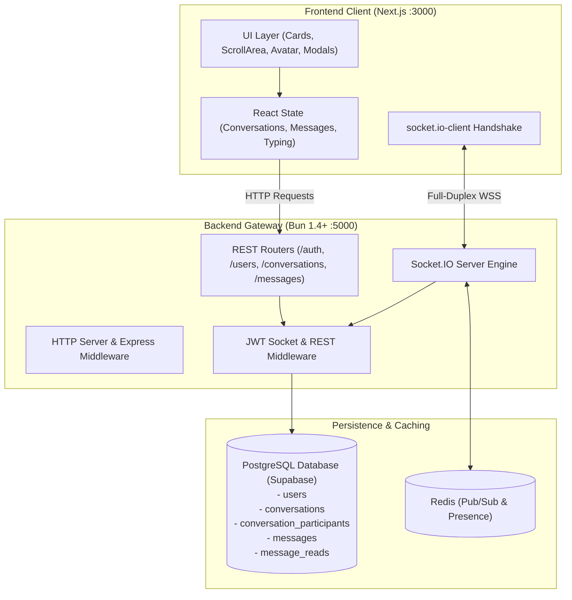
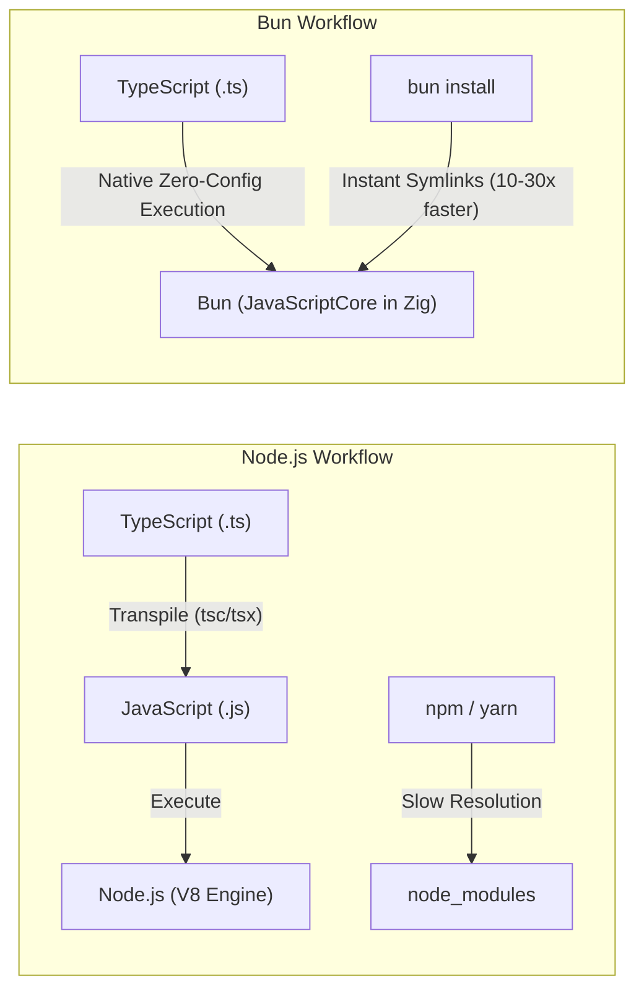

# 01. Architecture & System Design

This document covers the high-level system architecture, design paradigms, technology selections, and structural patterns used across the platform.

---

## 1. High-Level Architecture Overview

The system employs a **decoupled, hybrid client-server architecture**:
* **Frontend**: Next.js 14+ (React 19, TypeScript, Tailwind CSS, shadcn/ui).
* **Backend**: Bun 1.4+ runtime executing Express.js and Socket.IO in strict TypeScript.
* **Database**: PostgreSQL (via Supabase) with **Drizzle ORM**.
* **Real-Time Communication**: Persistent WebSocket connection with fallback to HTTP long-polling.



---

## 2. Why a Decoupled Architecture?

Instead of building a single monolith inside Next.js API routes or server actions, the backend and frontend are intentionally split into independent projects:

1. **Persistent WebSocket Lifecycle**:
   Next.js API routes are designed for serverless functions that freeze or terminate after executing a request. Real-time chat requires a continuously running event loop with persistent TCP sockets.
2. **Independent Scaling**:
   In high-traffic production environments, the frontend (static assets, UI bundles) can be distributed globally across CDNs (like Vercel or Cloudflare), while the backend socket cluster scales horizontally based on concurrent TCP connection loads.
3. **Fault Isolation**:
   A surge in message traffic or database writes on the backend will not crash or block the UI rendering pipeline.

---

## 3. Why Bun 1.4+ Over Node.js?

The backend is built on **Bun 1.4+**, modernizing the runtime layer:



| Factor | Node.js (Traditional) | Bun 1.4+ (Our Platform) |
| :--- | :--- | :--- |
| **Engine** | Google V8 (C++) | Apple JavaScriptCore (Written in Zig) |
| **TypeScript** | Requires `tsx`, `ts-node`, or `tsc` build step | **Native zero-config execution** directly on `.ts` files |
| **Package Management**| `npm install` takes 30-90 seconds | `bun install` takes 1-4 seconds with text `bun.lock` |
| **Memory per Socket** | Higher baseline RAM overhead | **Lower memory footprint per long-lived connection** |
| **Testing** | Requires configuring Jest / Babel | **Built-in `bun test` runner** executing in milliseconds |

---

## 4. Layered Backend Structure

The backend follows a **Layered Architecture (Separation of Concerns)**:

```
backend/
├── src/
│   ├── config/          # Infrastructure configurations (db.ts)
│   ├── middleware/      # Interceptors (auth.ts, socketAuth.ts)
│   ├── models/          # Mongoose Database Schemas (User.ts, Conversation.ts, Message.ts)
│   ├── routes/          # REST Endpoint Controllers (auth.ts, users.ts, conversations.ts, messages.ts)
│   ├── socket/          # Real-time WebSocket Event Handlers (index.ts)
│   ├── server.ts        # App Composition & Gateway Entry
│   └── server.test.ts   # Unit and Integration Test Suite
├── tsconfig.json        # Bun TypeScript configuration
└── package.json         # Package scripts & dependencies
```

### Flow of Execution
1. **Request / Event Entry**: Handled by Express Router (HTTP) or Socket.IO (WebSocket).
2. **Security & Authentication**: Validated by `authenticateToken` or `socketAuthMiddleware`.
3. **Data Layer**: Models execute indexed queries against MongoDB.
4. **Broadcast / Response**: Result is returned as JSON (REST) or emitted to the room (Socket.IO).
