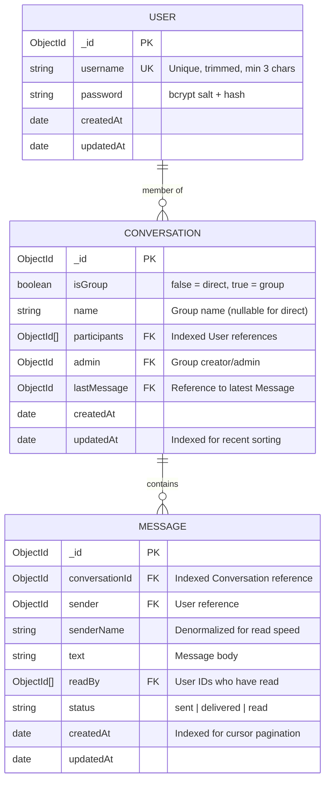

# 02. Database Models & Schema Design

This document details the MongoDB schema design, indexing strategies, relationship modeling, and performance considerations implemented using **Mongoose** and **TypeScript**.

---

## 1. Entity Relationship Overview

The platform uses three primary data models:
1. **User**: Represents registered user identities and credentials.
2. **Conversation**: Represents a chat room (either 1-on-1 direct or multi-user group) and holds the latest activity metadata.
3. **Message**: Represents individual chat messages belonging to a conversation.



---

## 2. Model Deep Dives & Code Implementation

### A. The User Model ([User.ts](file:///home/abhishekg/Projects/chat%20application%20trial/backend/src/models/User.ts))
```typescript
const UserSchema: Schema<IUser> = new Schema({
  username: {
    type: String,
    required: [true, 'Username is required'],
    unique: true,
    trim: true,
    minlength: [3, 'Username must be at least 3 characters long']
  },
  password: {
    type: String,
    required: [true, 'Password is required'],
    minlength: [6, 'Password must be at least 6 characters long']
  }
}, { timestamps: true });
```
* **Validation**: Enforces unique usernames, minimum lengths, and automatic whitespace trimming.
* **Security**: Plaintext passwords never touch the database; they are converted to bcrypt hashes before persistence.

---

### B. The Conversation Model ([Conversation.ts](file:///home/abhishekg/Projects/chat%20application%20trial/backend/src/models/Conversation.ts))
```typescript
const ConversationSchema: Schema<IConversation> = new Schema({
  isGroup: { type: Boolean, default: false },
  name: { type: String, trim: true },
  participants: [{ type: Schema.Types.ObjectId, ref: 'User', required: true }],
  admin: { type: Schema.Types.ObjectId, ref: 'User' },
  lastMessage: { type: Schema.Types.ObjectId, ref: 'Message' }
}, { timestamps: true });

// Compound Index: Speeds up querying user conversations sorted by recent activity
ConversationSchema.index({ participants: 1, updatedAt: -1 });
```

#### Why Compound Indexing Matters:
When a user logs in, the app queries:
```typescript
Conversation.find({ participants: userId }).sort({ updatedAt: -1 })
```
Without an index, MongoDB scans every conversation in the database ($\mathcal{O}(N)$). With the compound index `{ participants: 1, updatedAt: -1 }`, MongoDB performs a B-Tree range scan in $\mathcal{O}(\log N)$ time.

---

### C. The Message Model ([Message.ts](file:///home/abhishekg/Projects/chat%20application%20trial/backend/src/models/Message.ts))
```typescript
const MessageSchema: Schema<IMessage> = new Schema({
  conversationId: {
    type: Schema.Types.ObjectId,
    ref: 'Conversation',
    required: true,
    index: true
  },
  sender: { type: Schema.Types.ObjectId, ref: 'User', required: true },
  senderName: { type: String, required: true },
  text: { type: String, required: true, trim: true },
  readBy: [{ type: Schema.Types.ObjectId, ref: 'User' }],
  status: {
    type: String,
    enum: ['sent', 'delivered', 'read'],
    default: 'sent'
  }
}, { timestamps: true });

// Compound Index: Enables cursor-based pagination
MessageSchema.index({ conversationId: 1, createdAt: -1 });
```

---

## 3. Key Architectural Patterns in Data Design

### 1. Strategic Denormalization (`senderName`)
* **Problem**: In normalized databases, to show a sender's username beside a message bubble, you must execute a join/populate on every single message. In high-traffic chats with 50 messages, this generates 50 foreign key lookups.
* **Solution**: We store `senderName` directly on the `Message` document. Because usernames change rarely and reads outnumber writes 20:1, reading message history requires only a single database query.

### 2. Cursor-Based Pagination Over Offset Pagination
* **Why not `.skip(50).limit(50)`?**
  Offset pagination scans and discards 50 rows, causing performance degradation as offset grows ($\mathcal{O}(N)$). Additionally, if new messages are sent while a user is paginating, offset pagination produces duplicate or skipped items.
* **Cursor Pagination Implementation**:
  ```typescript
  const query = {
    conversationId: convId,
    createdAt: { $lt: new Date(beforeTimestamp) }
  };
  const messages = await Message.find(query).sort({ createdAt: -1 }).limit(50);
  ```
  This uses the `{ conversationId: 1, createdAt: -1 }` index to jump straight to the exact millisecond in $\mathcal{O}(\log N)$ time.
