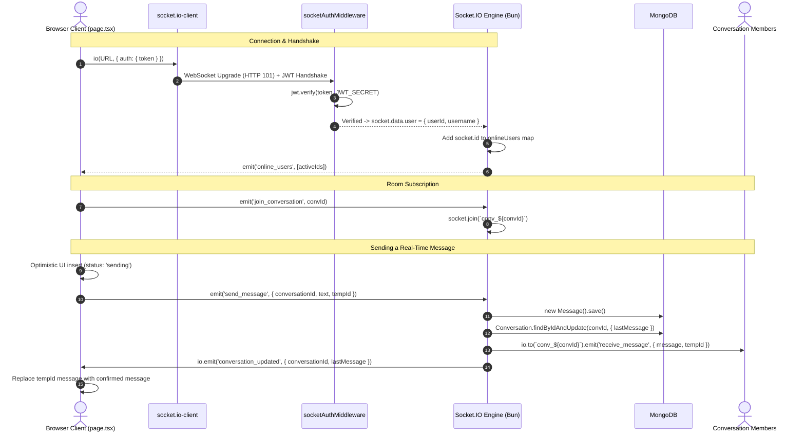

# 03. Real-Time Engine & Socket.IO

This document details the WebSocket networking layer, Socket.IO lifecycle, room routing, live presence engine, typing indicators, and read receipts implemented in [socket/index.ts](file:///home/abhishekg/Projects/chat%20application%20trial/backend/src/socket/index.ts).

---

## 1. The Real-Time Lifecycle



---

## 2. Event Dictionary Reference

| Event Name | Direction | Payload | Description |
| :--- | :--- | :--- | :--- |
| **`connection`** | Client ➔ Server | Handshake `{ auth: { token } }` | Authenticates socket and registers user identity. |
| **`online_users`** | Server ➔ All | `string[]` (Array of user IDs) | Broadcasts updated list of currently active users. |
| **`join_conversation`**| Client ➔ Server | `conversationId: string` | Subscribes socket to the room channel `conv_${id}`. |
| **`leave_conversation`**| Client ➔ Server | `conversationId: string` | Unsubscribes socket from room channel. |
| **`send_message`** | Client ➔ Server | `{ conversationId, text, tempId }` | Persists message to DB and broadcasts to room. |
| **`receive_message`** | Server ➔ Room | `{ message: Message, tempId }` | Delivers confirmed message to all active participants. |
| **`conversation_updated`**| Server ➔ All | `{ conversationId, lastMessage }` | Notifies sidebar to update last message preview and sort order. |
| **`typing_start`** | Client ➔ Server | `conversationId: string` | Informs room that user is typing. |
| **`typing_stop`** | Client ➔ Server | `conversationId: string` | Informs room that user stopped typing. |
| **`user_typing`** | Server ➔ Room Peers | `{ conversationId, userId, username }`| Triggers typing animation on recipient screens. |
| **`user_stop_typing`**| Server ➔ Room Peers | `{ conversationId, userId }` | Hides typing animation on recipient screens. |
| **`mark_as_read`** | Client ➔ Server | `conversationId: string` | Updates unread messages in DB to `read` status. |
| **`disconnect`** | Client ➔ Server | None | Cleans up socket descriptor and adjusts presence map. |

---

## 3. Core Engine Implementations

### A. Handshake Authentication ([socketAuth.ts](file:///home/abhishekg/Projects/chat%20application%20trial/backend/src/middleware/socketAuth.ts))
Unauthenticated sockets are rejected before accepting the connection:
```typescript
export const socketAuthMiddleware = (socket: Socket, next: (err?: Error) => void) => {
  const token = socket.handshake.auth?.token;
  if (!token) return next(new Error('Authentication failed: Missing token'));

  try {
    const decoded = jwt.verify(token, process.env.JWT_SECRET) as { userId: string; username: string };
    socket.data.user = decoded; // Attach identity
    next();
  } catch (err) {
    next(new Error('Authentication failed: Invalid token'));
  }
};
```

---

### B. Multi-Tab Presence Engine
Users often open multiple tabs simultaneously. If they close one tab, they should still appear **Online** if another tab remains open.

```typescript
// Maps userId -> Set of active socket IDs
const onlineUsers = new Map<string, Set<string>>();

// On Connect:
if (!onlineUsers.has(userId)) {
  onlineUsers.set(userId, new Set<string>());
}
onlineUsers.get(userId)?.add(socket.id);
io.emit('online_users', Array.from(onlineUsers.keys()));

// On Disconnect:
const userSockets = onlineUsers.get(userId);
if (userSockets) {
  userSockets.delete(socket.id);
  if (userSockets.size === 0) {
    onlineUsers.delete(userId); // Truly offline
    io.emit('online_users', Array.from(onlineUsers.keys()));
  }
}
```

---

### C. Client Typing Indicator with Debouncing
To prevent spamming the WebSocket channel with an event on every keystroke, typing events are debounced on the client:

```typescript
// frontend/src/app/page.tsx
const handleInputChange = (e: React.ChangeEvent<HTMLInputElement>) => {
  setMessageInput(e.target.value);
  if (!socket || !activeConversation) return;

  socket.emit('typing_start', activeConversation._id);

  if (typingTimeoutRef.current) {
    clearTimeout(typingTimeoutRef.current);
  }

  // Automatically emit typing_stop if user pauses for 1.5 seconds
  typingTimeoutRef.current = setTimeout(() => {
    socket.emit('typing_stop', activeConversation._id);
  }, 1500);
};
```
