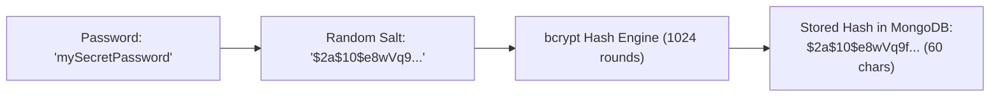
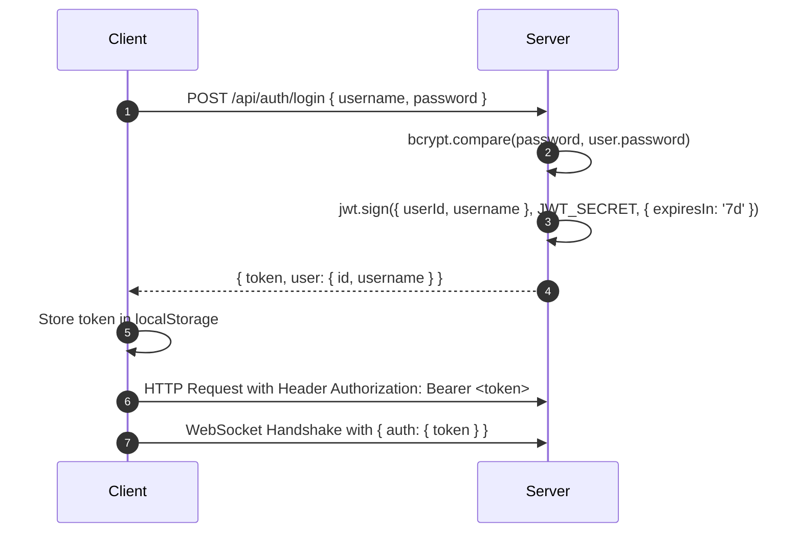

# 04. Security & Authentication

This document details the cryptographic security, password hashing, token lifecycle, authorization middleware, and vulnerability mitigations implemented in the platform.

---

## 1. Cryptographic Password Protection (bcryptjs)

Plaintext passwords are never saved to the database. During registration in [auth.ts](file:///home/abhishekg/Projects/chat%20application%20trial/backend/src/routes/auth.ts):

```typescript
// Generate pseudo-random salt with work factor 10
const salt = await bcrypt.genSalt(10);
// Combine salt with plaintext password into irreversible cryptographic hash
const hashedPassword = await bcrypt.hash(password, salt);
```



### Why Hashing with Salt?
1. **One-Way Mathematical Function**: It is computationally infeasible to derive the original password from the hash.
2. **Mitigation of Rainbow Table Attacks**: Because the salt is unique per user, identical passwords produce completely different hash strings in the database.
3. **Adaptive Work Factor**: The cost factor (`10`) forces attackers attempting offline brute-force attacks to spend substantial computational power per guess.

---

## 2. Stateless JSON Web Token (JWT) Lifecycle

When a user logs in via `POST /api/auth/login`:



### JWT Structure
* **Header**: Contains algorithm (`HS256`) and token type (`JWT`).
* **Payload**: Contains minimal non-sensitive identity claims: `{ userId: "64a1b2...", username: "Alice" }`.
* **Signature**: `HMACSHA256(base64UrlEncode(header) + "." + base64UrlEncode(payload), JWT_SECRET)`.

---

## 3. Route & Middleware Protection

### A. Express REST Middleware ([auth.ts](file:///home/abhishekg/Projects/chat%20application%20trial/backend/src/middleware/auth.ts))
Protects routes like `/api/users`, `/api/conversations`, and `/api/messages`.

```typescript
export const authenticateToken = (req: AuthRequest, res: Response, next: NextFunction) => {
  const authHeader = req.headers['authorization'];
  const token = authHeader && authHeader.split(' ')[1];

  if (!token) return res.status(401).json({ error: 'Access denied: No token provided' });

  try {
    const decoded = jwt.verify(token, process.env.JWT_SECRET!) as { userId: string; username: string };
    req.user = decoded;
    next();
  } catch (err) {
    res.status(403).json({ error: 'Invalid or expired token' });
  }
};
```

---

## 4. Cross-Origin Resource Sharing (CORS) Firewall

To prevent unauthorized domains from making API requests or establishing WebSocket connections:

```typescript
// backend/src/server.ts
const allowedOrigin = process.env.FRONTEND_URL || 'http://localhost:3000';

app.use(cors({
  origin: allowedOrigin,
  credentials: true,
  methods: ['GET', 'POST', 'PUT', 'DELETE', 'OPTIONS']
}));

const io = new SocketIOServer(server, {
  cors: {
    origin: allowedOrigin,
    methods: ['GET', 'POST'],
    credentials: true
  }
});
```

---

## 5. Production Hardening Checklist

| Vector | Current Implementation | Production Hardening Recommendation |
| :--- | :--- | :--- |
| **Token Storage** | `localStorage` | Use **`HttpOnly` + `Secure` + `SameSite=Strict` cookies** to prevent XSS script access. |
| **Rate Limiting** | Open | Add **`express-rate-limit`** to `/api/auth/login` (max 5 tries per min). |
| **Message Sanitization** | React JSX escaping | Add **`DOMPurify` / `sanitize-html`** on the backend to strip nested tags. |
| **Password Leak Prevention** | `.select('-password')` | Standardized Mongoose schema transform `toJSON: { transform: (doc, ret) => { delete ret.password; } }`. |
