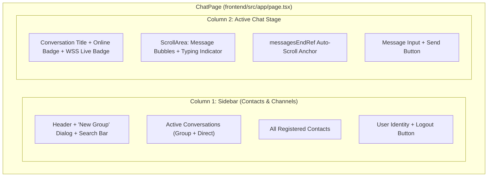
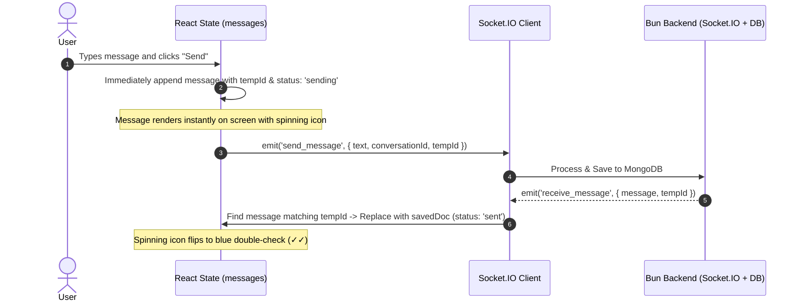

# 05. Frontend Engineering & React Lifecycle

This document explains the frontend architecture, state management, optimistic UI updates, and Next.js 14+ / React 19 patterns implemented in [page.tsx](file:///home/abhishekg/Projects/chat%20application%20trial/frontend/src/app/page.tsx).

---

## 1. Component Architecture & UI Breakdown

The frontend is structured into a responsive two-column layout using **Tailwind CSS** and **shadcn/ui**:



---

## 2. Optimistic UI Updates Explained

In real-time messaging, waiting for the server and database to acknowledge a message before displaying it creates perceived lag (100–300ms).

The app implements **Optimistic UI Rendering**:



### Implementation in Code:
```typescript
// 1. Instantly create temporary optimistic message
const tempId = `temp_${Date.now()}_${Math.random()}`;
const optimisticMsg: Message = {
  _id: tempId,
  tempId,
  conversationId: activeConversation._id,
  sender: currentUserId,
  senderName: currentUsername,
  text: textToSend,
  status: 'sending',
  createdAt: new Date().toISOString()
};

setMessages((prev) => [...prev, optimisticMsg]);

// 2. Reconcile upon backend confirmation
socketClient.on('receive_message', ({ message, tempId }) => {
  setMessages((prev) => {
    if (tempId && prev.some((m) => m.tempId === tempId)) {
      return prev.map((m) => (m.tempId === tempId ? message : m));
    }
    return [...prev, message];
  });
});
```

---

## 3. Auto-Scrolling Mechanism with `useRef`

When reading or sending messages, the view should automatically scroll to the newest message at the bottom.

```typescript
const messagesEndRef = useRef<HTMLDivElement>(null);

// Triggers whenever messages array changes
useEffect(() => {
  messagesEndRef.current?.scrollIntoView({ behavior: 'smooth' });
}, [messages]);
```

In JSX, an empty `<div>` anchor is placed at the end of the scroll list:
```tsx
<div className="flex flex-col gap-4">
  {messages.map((msg) => (
    <MessageBubble key={msg._id} message={msg} />
  ))}
  <div ref={messagesEndRef} />
</div>
```

---

## 4. Live Network Resilience (Graceful Degradation)

The UI dynamically reacts to connection drops:

```typescript
socketClient.on('connect', () => setIsConnected(true));
socketClient.on('disconnect', () => setIsConnected(false));
```

* **When Connected**: The header shows a green `WSS LIVE` badge, and input controls are active.
* **When Disconnected**: The header pulses a red `RECONNECTING...` badge, and the `<Input>` and `<Button>` are physically disabled (`disabled={!isConnected}`) to prevent messages from being lost during outages.
