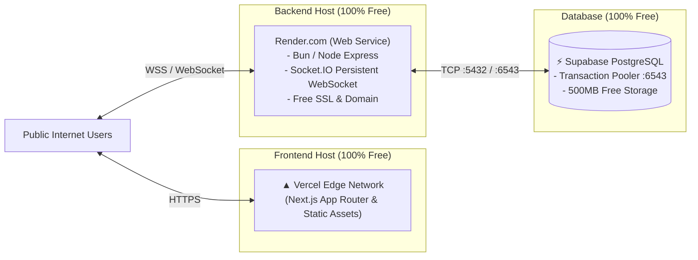

# 06. Free Production Deployment & DevOps Guide

This guide walks through deploying your real-time chat application to the public internet **100% free forever** with custom HTTPS domains and active WebSockets.

---

## 🏗️ The 100% Free Production Architecture



---

## 🚀 Step 1: Push Code to GitHub

1. Initialize git and commit all changes:
   ```bash
   git init
   git add .
   git commit -m "feat: complete real-time chat application with postgres and nextjs"
   ```
2. Create a new repository on [GitHub](https://github.com/new) named `chat-application`.
3. Link and push your code:
   ```bash
   git remote add origin https://github.com/YOUR_GITHUB_USERNAME/chat-application.git
   git branch -M main
   git push -u origin main
   ```

---

## ⚡ Step 2: Deploy Backend to Render.com (100% Free)

**Render** gives you a free Linux web service with persistent WebSocket support and free HTTPS.

1. Go to **[Render.com](https://render.com)** and sign up / log in with GitHub.
2. Click **New +** ➔ **Web Service**.
3. Select your **`chat-application`** repository from GitHub.
4. Fill in the settings:
   * **Name**: `chatapp-backend-trial` *(or any unique name)*
   * **Root Directory**: `backend`
   * **Environment**: `Docker` *(Render will automatically detect [`backend/Dockerfile`](file:///home/abhishekg/Projects/chat%20application%20trial/backend/Dockerfile))*
   * **Instance Type**: **Free** ($0/month)
5. Scroll down to **Environment Variables** and add:
   | Key | Value |
   | :--- | :--- |
   | `DATABASE_URL` | Your Supabase connection string |
   | `JWT_SECRET` | `your_production_secret_key_12345` |
   | `FRONTEND_URL` | `*` *(or your Vercel URL once deployed)* |
   | `PORT` | `5000` |
6. Click **Create Web Service**.
7. Render will build the Docker container and provide you a free public URL, e.g.:
   `https://chatapp-backend-trial.onrender.com`

---

## ▲ Step 3: Deploy Frontend to Vercel (100% Free)

**Vercel** is the official cloud platform for Next.js and provides instant global CDN deployment.

1. Go to **[Vercel.com](https://vercel.com)** and log in with GitHub.
2. Click **Add New...** ➔ **Project**.
3. Import your **`chat-application`** repository.
4. In the configuration screen:
   * **Framework Preset**: Next.js (detected automatically)
   * **Root Directory**: Click *Edit* and select **`frontend`**.
5. Under **Environment Variables**, add:
   | Key | Value |
   | :--- | :--- |
   | `NEXT_PUBLIC_BACKEND_URL` | Your Render Backend URL (e.g. `https://chatapp-backend-trial.onrender.com`) |
6. Click **Deploy**.
7. In ~60 seconds, Vercel will give you your live public website, e.g.:
   `https://chat-application-iota.vercel.app`

---

## 🔄 Step 4: Link Frontend & Backend CORS

1. Once you have your Vercel frontend URL, go back to **Render.com** ➔ Your Backend Service ➔ **Environment**.
2. Update `FRONTEND_URL` to your exact Vercel domain:
   ```env
   FRONTEND_URL=https://chat-application-iota.vercel.app
   ```
3. Click **Save Changes** (Render will automatically redeploy in 30 seconds).

---

## 🛡️ Step 5: Keep the Free Backend Awake (Optional Free Trick)

On Render's free tier, services sleep after 15 minutes of inactivity and take ~30 seconds to wake up on the first visit.

**How to keep it 100% awake 24/7 for free:**
1. Create a free account at **[Cron-Job.org](https://cron-job.org)** or **[UptimeRobot.com](https://uptimerobot.com)**.
2. Add an HTTP monitor to ping your backend health endpoint every 10 minutes:
   ```text
   https://chatapp-backend-trial.onrender.com/health
   ```
3. This prevents the free service from ever sleeping!
