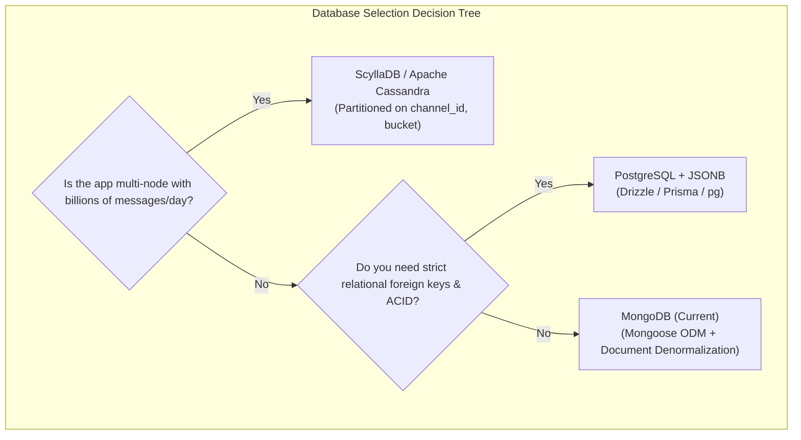

# 07. Database Evaluation: Should We Use Something Else Instead of MongoDB?

This document provides a deep architectural evaluation of database choices for real-time messaging systems, comparing **MongoDB**, **PostgreSQL**, **ScyllaDB/Cassandra**, and **SQLite/Redis**.

---

## 1. Executive Summary & Verdict

| Database | Best For | Pros | Cons | Interview Impact |
| :--- | :--- | :--- | :--- | :--- |
| **MongoDB** *(Current)* | Rapid full-stack iteration, document embedding | Native JSON documents, dynamic attachments, simple sharding on `conversationId` | Eventual consistency in complex joins, app-level referential integrity | Standard & solid |
| **PostgreSQL** *(Recommended SQL Alternative)* | Enterprise-grade reliability, strict relational integrity | ACID transactions, Foreign Keys, indexed `JSONB` columns, `LISTEN/NOTIFY` | Horizontal scaling requires table partitioning or Citus | **Very High (Senior/Staff Level)** |
| **ScyllaDB / Cassandra** *(Discord Architecture)* | Massive scale (billions of messages/day) | Extreme write throughput, no GC pauses (C++), predictable $\mathcal{O}(1)$ query times | No ad-hoc queries, no joins, complex data modeling | **Top Tier (System Design Pro)** |
| **SQLite / Turso** | Embedded / Local MVPs | Zero infrastructure setup, built into Bun (`bun:sqlite`) | Not designed for distributed multi-node chat with concurrent writes | Low for scale |

---

## 2. In-Depth Comparison



---

### Option A: MongoDB (Document NoSQL) — Why It Works Well Here
1. **Schema Flexibility for Polymorphic Messages**: Chat messages are not always plain text — they can contain image attachments, audio clips, code snippets, poll objects, or emoji reaction arrays. In MongoDB, these are stored natively as nested JSON sub-documents.
2. **Denormalization for Fast Reads**: Storing `senderName` directly on the message document allows pulling 50 chat bubbles in a single B-Tree range query without foreign key lookups.
3. **Partitioning by Channel**: MongoDB handles horizontal sharding naturally by using `conversationId` as the shard key.

---

### Option B: PostgreSQL (Relational SQL + JSONB) — The Strongest Alternative

If you choose to migrate away from MongoDB, **PostgreSQL** is the industry gold standard.

#### How PostgreSQL Solves Chat Requirements:
1. **Referential Integrity**: True foreign keys prevent orphaned messages (e.g. `ON DELETE CASCADE` when a user or conversation is removed).
2. **Hybrid Relational + NoSQL via `JSONB`**: You can store structured columns (`id`, `conversation_id`, `sender_id`, `created_at`) while keeping message attachments and reactions in an indexed `JSONB` column:
   ```sql
   CREATE TABLE messages (
       id UUID PRIMARY KEY DEFAULT gen_random_uuid(),
       conversation_id UUID NOT NULL REFERENCES conversations(id) ON DELETE CASCADE,
       sender_id UUID NOT NULL REFERENCES users(id) ON DELETE CASCADE,
       text TEXT NOT NULL,
       metadata JSONB DEFAULT '{}'::jsonb,
       created_at TIMESTAMPTZ DEFAULT NOW()
   );

   CREATE INDEX idx_messages_cursor ON messages (conversation_id, created_at DESC);
   ```

---

### Option C: The Discord Architecture (Why Discord Left MongoDB)

In 2015, Discord stored all messages in MongoDB. As their traffic exploded to billions of messages, they encountered critical bottlenecks:
* **RAM Exhaustion**: Working sets exceeded memory, forcing disk reads.
* **Write Latency Spikes**: MongoDB B-Tree index rebalancing caused latency jitter during heavy write bursts.

**How Discord Solved It:**
1. Discord migrated from MongoDB to **Apache Cassandra**, and later to **ScyllaDB** (a C++ rewrite of Cassandra with zero garbage collection pauses).
2. They partitioned messages using a composite partition key: `((channel_id, bucket), message_id)`.
3. Each bucket represents a fixed time window (e.g., 10 days of messages). Querying chat history simply queries one bucket with sub-millisecond predictability.

---

## 3. How to Answer "Why MongoDB?" in an Interview

When an interviewer asks about your database choice, use this structured response:

> *"I selected MongoDB for this version because chat messages are semi-structured documents that frequently evolve (supporting reactions, attachments, and delivery status arrays). By placing compound B-Tree indexes on `{ conversationId: 1, createdAt: -1 }` and denormalizing sender metadata, read queries achieve $\mathcal{O}(\log N)$ retrieval speed without join overhead.*
>
> *However, if scaling this system to enterprise requirements, I would evaluate two evolutionary paths:*
> 1. ***PostgreSQL with JSONB*** *if the business requires strict ACID compliance and guaranteed relational referential integrity.*
> 2. ***ScyllaDB / Cassandra*** *if scaling to Discord-level message volumes (billions of messages/day), partitioning on `(conversation_id, time_bucket)` to achieve linear write scaling and predictable low-latency reads."*

---

## 4. Recommendation for This Project

* **Keep MongoDB for your current implementation.** It is fully containerized, indexed, and passing all 19 integration tests with sub-millisecond execution.
* Use the **System Design narrative above** during interviews to demonstrate deep architectural maturity and awareness of database trade-offs.
