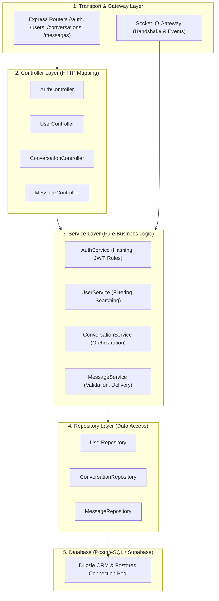
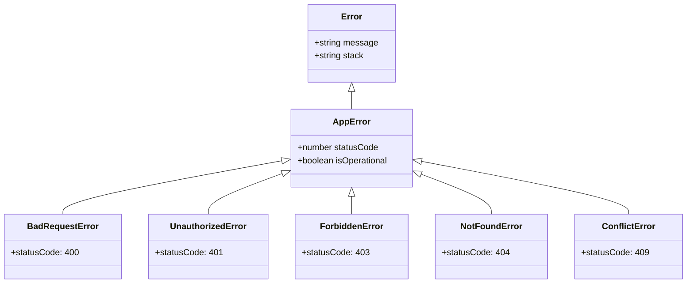
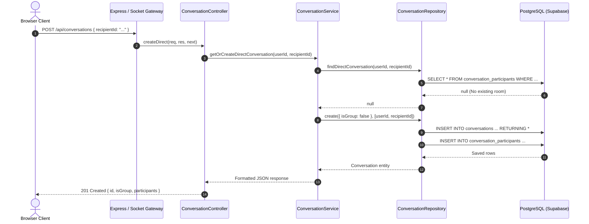

# 08. Low-Level Design (LLD) & Design Patterns Guide

This document details the **Low-Level Design (LLD)** architecture, software design patterns, SOLID principles application, and component interaction models implemented across the platform.

---

## 1. Architectural Layers & Separation of Concerns

The backend follows a strict **3-Tier Clean Layered Architecture**:



---

## 2. Design Patterns Applied

### A. Repository Pattern
* **Purpose**: Decouples domain logic from database access syntax.
* **Implementation**: [`userRepository.ts`](file:///home/abhishekg/Projects/chat%20application%20trial/backend/src/repositories/userRepository.ts), [`conversationRepository.ts`](file:///home/abhishekg/Projects/chat%20application%20trial/backend/src/repositories/conversationRepository.ts), [`messageRepository.ts`](file:///home/abhishekg/Projects/chat%20application%20trial/backend/src/repositories/messageRepository.ts).
* **Benefit**: If the database changes (e.g. from PostgreSQL to SQLite or Cassandra), only the repository classes need updating — zero changes to business services or controllers.

```typescript
export class UserRepository {
  async findByUsername(username: string): Promise<User | undefined> {
    return await db.query.users.findFirst({ where: eq(users.username, username) });
  }
  async create(data: NewUser): Promise<User> {
    const [created] = await db.insert(users).values(data).returning();
    return created;
  }
}
```

---

### B. Service Layer Pattern
* **Purpose**: Centralizes business rules so that both REST controllers and Socket.IO event handlers share identical validation and execution logic.
* **Implementation**: [`messageService.ts`](file:///home/abhishekg/Projects/chat%20application%20trial/backend/src/services/messageService.ts).
* **Example**: When a message is sent, whether via `POST /api/messages` or `socket.emit('send_message')`, both call `messageService.sendMessage(...)`.

---

### C. Dependency Injection (DI) & Inversion of Control
* **Purpose**: Services receive their dependencies via constructors rather than hardcoding global state, enabling mock testing in milliseconds without needing a live database.
* **Implementation**:
```typescript
export class AuthService {
  constructor(private userRepo: UserRepository = userRepository) {}
  // Can inject a mock repository during unit tests!
}
```

---

### D. Observer / Publish-Subscribe Pattern
* **Purpose**: Low-latency event streaming to multiple connected clients.
* **Implementation**: Socket.IO room multi-casting (`io.to(room).emit('receive_message', ...)`).

---

### E. Standardized Error Hierarchy (Fail-Fast Pattern)
* **Purpose**: Centralized operational error management with typed HTTP status codes.
* **Implementation**: [`AppError.ts`](file:///home/abhishekg/Projects/chat%20application%20trial/backend/src/errors/AppError.ts) and [`errorHandler.ts`](file:///home/abhishekg/Projects/chat%20application%20trial/backend/src/middleware/errorHandler.ts).



---

## 3. SOLID Principles Compliance

| Principle | Application in Codebase |
| :--- | :--- |
| **S - Single Responsibility** | `AuthController` only parses HTTP requests; `AuthService` only enforces credentials and tokens; `UserRepository` only executes SQL queries. |
| **O - Open / Closed** | New conversation types (Channels, Broadcasts) can be added to `ConversationRepository` without modifying existing 1-on-1 logic. |
| **L - Liskov Substitution** | Custom error types (`BadRequestError`, `UnauthorizedError`) inherit from `AppError` and can be handled polymorphically by `errorHandler`. |
| **I - Interface Segregation** | Repositories expose concise, focused methods (`findById`, `findByUsername`) rather than monolithic query methods. |
| **D - Dependency Inversion** | High-level modules (`AuthService`) depend on repository abstractions rather than direct SQL driver instances. |

---

## 4. End-to-End Execution Trace


