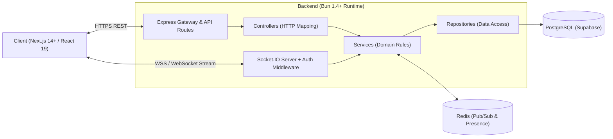

# Real-Time Chat Platform: Master Engineering Documentation

Welcome to the comprehensive technical documentation for the **Full-Stack Real-Time Chat Platform**.

This documentation is written to provide a thorough, step-by-step understanding of how every component of this application is architected, implemented, secured, tested, and scaled.

---

## 📚 Documentation Index

| Section | Document | Description |
| :--- | :--- | :--- |
| **01** | [**Architecture & System Design**](./01_ARCHITECTURE_AND_SYSTEM_DESIGN.md) | High-level system architecture, decoupled design, Bun 1.4+ runtime advantages, and layered services. |
| **02** | [**Database Models & Schema Design**](./02_DATABASE_MODELS_AND_SCHEMA_DESIGN.md) | Relational PostgreSQL schema (`users`, `conversations`, `conversation_participants`, `messages`, `message_reads`), composite indexing, and normalization. |
| **03** | [**Real-Time Engine & Socket.IO**](./03_REALTIME_ENGINE_AND_SOCKET_IO.md) | WebSocket protocol, Socket.IO room topology, presence engine, typing debouncing, and read receipts. |
| **04** | [**Security & Authentication**](./04_SECURITY_AND_AUTHENTICATION.md) | Bcrypt password salting/hashing, JWT tokens, Socket Handshake Auth middleware, and CORS security. |
| **05** | [**Frontend Engineering & React State**](./05_FRONTEND_ENGINEERING_AND_REACT_LIFECYCLE.md) | Next.js App Router, optimistic UI reconciliation, presence tracking, and UI component hierarchy. |
| **06** | [**Deployment & DevOps Guide**](./06_DEPLOYMENT_AND_DEVOPS_GUIDE.md) | Cloud hosting guide (Vercel, Railway, Supabase PostgreSQL), Docker containerization, and `docker-compose`. |
| **07** | [**Database Evaluation: MongoDB vs PostgreSQL vs ScyllaDB**](./07_DATABASE_EVALUATION_MONGODB_VS_POSTGRESQL.md) | Architectural trade-offs, Discord case study, relational vs NoSQL analysis, and interview talking points. |
| **08** | [**Low-Level Design (LLD) & Design Patterns**](./08_LOW_LEVEL_DESIGN_LLD_PATTERNS.md) | 3-Tier Layered Architecture, Repository Pattern, Service Layer Pattern, Dependency Injection, and SOLID principles. |

---

## ⚡ Quick Start Guide (Local Development)

### 1. Prerequisites
* **Bun Runtime (v1.4+)**: Install via `curl -fsSL https://bun.sh/install | bash`
* **PostgreSQL Database**: Free cloud database on Supabase (configured via `DATABASE_URL` in `backend/.env`).

### 2. Running the Backend
```bash
cd backend
bun install
bun run db:push
bun run dev
```
* Backend runs on: `http://localhost:5000`
* Test suite: `bun test`

### 3. Running the Frontend
```bash
cd frontend
bun install
bun run dev
```
* Frontend runs on: `http://localhost:3000`

---

## 🎯 Architecture Summary at a Glance


